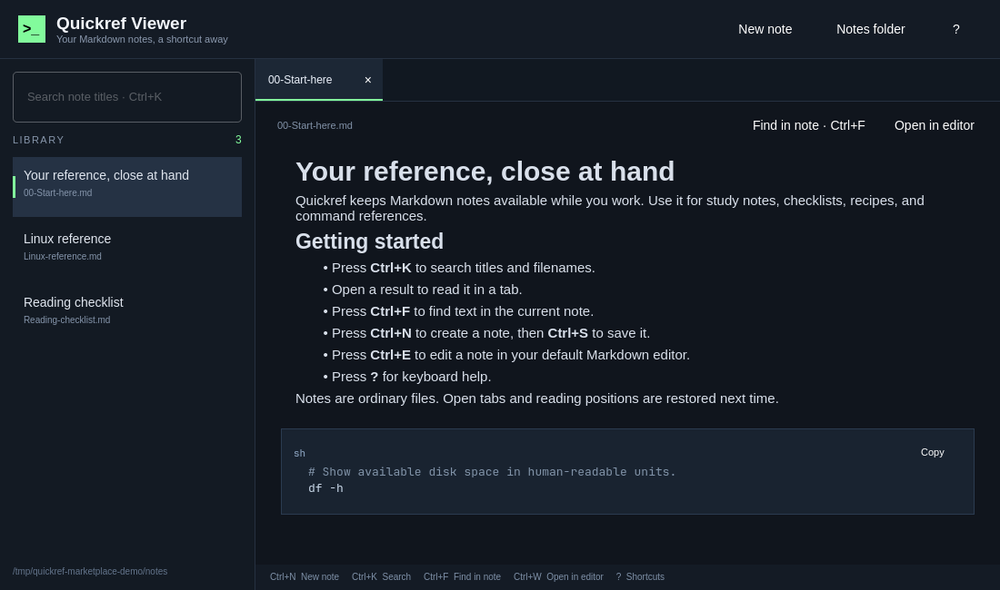

# Quickref Viewer

Your Markdown notes, a shortcut away. Press **Super+Alt+grave** to slide Quickref Viewer down from the top of the screen. Find what you need, then press the same shortcut to hide it and return to work.



Quickref Viewer is a native C++17 / Qt Quick application with an Omarchy Quattro bar plugin and a dedicated Hyprland special workspace. It remembers open tabs and reading positions. Notes are ordinary Markdown files; existing files are never overwritten when creating a note.

## Requirements

- Omarchy Quattro with Lua-based Hyprland configuration and the `hl` / `o` helpers. Older `hyprland.conf` installations are unsupported.
- Runtime: `qt6-base`, `qt6-declarative`, `qt6-wayland`, `glib2` (external editor/file manager), `libnotify` (setup errors).
- Build: `base-devel`, including a C++17 compiler and make, plus `qmake6` from Qt.

## Manual installation

This plugin requires a native build and explicit hotkey setup. Installing the repository alone is insufficient. Marketplace maintainers should mark this listing **manual-setup**.

1. Place this repository at `~/.config/omarchy/plugins/io.github.qrooto.quickref-viewer`.
2. Build and test it from that directory:

   ```sh
   ./bin/build
   ./bin/test
   ```

3. Back up your Hyprland configuration. Copy `integration/quickref_viewer.lua` to `~/.config/hypr/quickref_viewer.lua`. Add this after the default modules in `~/.config/hypr/hyprland.lua`:

   ```lua
   require("hypr.quickref_viewer")
   ```

4. Check that **Super+Alt+grave** is available before enabling the module. The module registers that shortcut; edit its binding if you prefer another. `grave` is the physical backtick/tilde key, without Shift.
5. Run `hyprctl reload`, then `hyprctl configerrors`. Resolve any errors before using the shortcut.
6. Optionally enable the plugin in Omarchy and add **Quickref Viewer** to the bar through the bar editor. Clicking it performs the same drop-down toggle.

The panel uses `special:quickref-viewer`, 65% of usable screen height and 86% of width (minimum width 900, capped to the monitor). It uses Omarchy's existing special-workspace slide animation. Hiding preserves the process and reading position. Opening a note in an external editor hides the panel and opens the editor in the underlying regular workspace.

No installer edits your Hyprland configuration, bar layout, or keybindings automatically. The module is loaded only after you explicitly add the `require` line. No root access is required for the build or plugin setup.

## Notes and language

Quickref Viewer uses `~/Notes/quickref-viewer` and `~/.local/share/quickref-viewer/session.json`. These are separate from the original Quickref Viewer application's notes and session. Add Markdown files manually, use **Ctrl+N**, or copy the English examples with `cp -n examples/*.md ~/Notes/quickref-viewer/` after creating the directory.

English is the default, regardless of the desktop language. Russian and Danish remain optional. Set `QUICKREF_LANGUAGE=ru`, `da`, or `system` in the environment inherited by Quickref Viewer to choose a translation or follow Omarchy's language setting. Missing translations fall back to English. Theme changes are followed live.

New notes require a Linux filesystem that supports `O_TMPFILE` and hard links, and a mounted `/proc`. The selected notes root must be a real directory, not a symlink. Creation fails with an error if these requirements are unavailable; it never falls back to an unsafe save. New notes are written to an unnamed file with owner-only permissions, then published atomically without replacing any existing directory entry.

## Keyboard

| Shortcut | Action |
| --- | --- |
| Super+Alt+grave | Show / hide the drop-down |
| Ctrl+K | Search titles and filenames |
| Ctrl+F | Find in the current note |
| Enter / Shift+Enter, F3 / Shift+F3 | Next / previous match |
| Escape | Close find |
| Ctrl+Tab / Ctrl+Shift+Tab | Next / previous tab |
| Ctrl+N | Create a note |
| Ctrl+S | Save a new note |
| Ctrl+E / Ctrl+W | Open in external editor |
| Ctrl+O | Open notes folder |
| F5 | Reload notes |
| ? | Keyboard help |
| Q | Quit when search is not focused |

## Security regression tests

After `./bin/build`, run `./bin/test` for Qt regression coverage, including deterministic path-substitution tests. With Python 3 available, run `python3 tests/cli_skill_install.py` to exercise the actual CLI: concurrent installation, preservation of user instructions and symlink targets, owner-only file permissions, JSON output, and exit status. These checks use temporary directories and a temporary `CODEX_HOME`; they do not install into the current user’s Codex settings.

## Isolated development preview

`./bin/preview` opens the application with copies of the English examples and session state under `.preview/` in this checkout. It does not install the drop-down integration. Use it for UI inspection; the installed plugin's normal entry point is `./bin/launch`, which toggles the special workspace.

For an offscreen screenshot:

```sh
QT_QPA_PLATFORMTHEME=basic QT_QPA_PLATFORM=offscreen QT_QUICK_BACKEND=software \
  ./bin/preview --screenshot "$PWD/preview.png"
```

## Command line

```sh
./build/quickref-viewer create --name "Reading list" --text "# Reading list" --json
./build/quickref-viewer create --name "Checklist" --stdin --json
./build/quickref-viewer --notes /path/to/notes --state /path/to/session.json
```

`create` runs without a display and exits 0 on success, 1 on failure. `skill install` explicitly installs agent instructions under `$CODEX_HOME/skills/quickref-viewer` (default `~/.codex/skills/quickref-viewer`). It is never run automatically. Installation only creates a new `SKILL.md`; any existing file, hard link, or symlink (including a dangling symlink) is refused without replacement. The selected Codex home and skill directories must be owned by the current user and must not be writable by group or others; symlinks in the installation path are rejected.

## Removal

1. Quit the Quickref Viewer window with Q when search is not focused.
2. Remove only `require("hypr.quickref_viewer")` from `~/.config/hypr/hyprland.lua` and reload Hyprland. This removes the plugin hotkey and workspace rules.
3. Remove the Quickref Viewer widget from the bar and disable/remove `io.github.qrooto.quickref-viewer` through Omarchy's plugin manager.
4. Delete `~/.config/hypr/quickref_viewer.lua` and the plugin repository if they remain.

Notes and session data remain intact. Delete `~/Notes/quickref-viewer` and `~/.local/share/quickref-viewer` only if you no longer want them. The original Quickref Viewer installation is separate.

## Safe library reads

Linux 5.6 or newer with `openat2` is required. The application keeps the opened notes-root directory for its lifetime and enumerates directories by descriptor. Every descendant is opened beneath that root with symlinks, magic links, and mount crossings prohibited. Only regular files are read, through the same opened descriptor that was checked. Symbolic links and mounted subtrees are not indexed. If the kernel cannot enforce these restrictions, reading fails with a reported error; there is no pathname-based fallback. Restart the application to select a replacement root directory.

## Data and capabilities

The application reads and watches the selected notes directory, writes new notes and its session file atomically, reads Omarchy theme/language settings, accesses the clipboard when copying, and opens the default editor/file manager on request. It uses `hyprctl` for compositor integration. Images and raw HTML in notes are not rendered; links open only when clicked. It has no background network requests, telemetry, downloaded executable code, or automatic configuration edits.

## License

MIT. Omarchy theme and translation templates retain their attribution in LICENSE.
