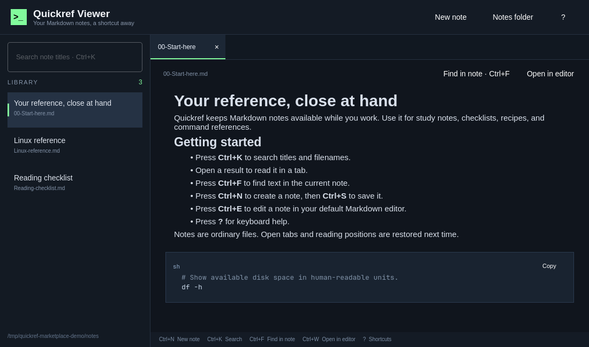

# Quickref

[English](README.md) | **Русский**

Ваши Markdown-заметки — на расстоянии одного сочетания клавиш. Quickref — лёгкое выпадающее окно для всего, что нужно держать под рукой: личных записей, учебных материалов, рецептов, списков дел, справочников по командам и многого другого. Написано на C++17 и Qt Quick для Omarchy.



Нажмите **Super + ~**, чтобы открыть панель поверх рабочего окна. Повторное нажатие скроет её.

Заметки — обычные файлы `.md` в `~/Notes/cheatsheets`. Вложенные папки индексируются автоматически. Боковая панель ищет по заголовкам и именам файлов, а выбранные заметки открываются во вкладках. В блоках кода есть простая подсветка и кнопка копирования. Открытые вкладки и положение прокрутки сохраняются после скрытия и перезапуска приложения. Добавленные и изменённые файлы появляются автоматически.

**Новая заметка** (Ctrl+N) открывает встроенную форму Markdown. Ctrl+S сохраняет новый файл атомарно, без перезаписи существующих файлов. При отмене приложение спрашивает, нужно ли отбросить черновик. **Открыть в редакторе** (Ctrl+W или Ctrl+E) использует системную ассоциацию Markdown-файлов, скрывает Quickref и открывает редактор на обычном рабочем столе под панелью. **Папка заметок** открывает там же файловый менеджер. Закрыть вкладку можно кнопкой ×. Состояние сессии атомарно сохраняется в `~/.local/share/quickref/session.json`.

## Сборка и установка

Нужны Qt 6 base и declarative, qmake6, make и компилятор C++17. Для интеграции с рабочим столом Arch-пакет также использует Qt Wayland, `xdg-utils` и `glib2`.

В Arch Linux / Omarchy:

```sh
sudo pacman -S --needed base-devel qt6-base qt6-declarative qt6-wayland xdg-utils glib2
git clone https://github.com/qrooto/quickref.git
cd quickref
./bin/build
./bin/test
```

Установка для текущего пользователя:

```sh
./bin/install-user
~/.local/bin/quickref open
```

Скрипт устанавливает собранный бинарный файл, иконку и ярлык приложения в `~/.local` без прав root. Другой вариант — `./bin/install`: он собирает и устанавливает Arch-пакет через `makepkg -fsi`. Чтобы только собрать пакет, выполните `makepkg -f` в `pkgbuild/`.

Первый запуск с примерами, без изменения вашей библиотеки:

```sh
./build/quickref --notes "$PWD/examples" --state /tmp/quickref-example-session.json
```

## Интеграция с Omarchy

Для выпадающей панели нужна конфигурация Hyprland на Lua из Omarchy с помощниками `hl` / `o`. Этот модуль не подходит для старой конфигурации `hyprland.conf`. Без интеграции Quickref можно запускать как обычное окно.

Скопируйте `integration/quickref.lua` в `~/.config/hypr/quickref.lua` и добавьте после стандартных модулей в `~/.config/hypr/hyprland.lua`:

```lua
require("hypr.quickref")
```

Интеграция запускает `~/.local/bin/quickref`. При установке только через пакет замените эту команду в модуле на `quickref open`.

Затем выполните `hyprctl reload` и `hyprctl configerrors`.

Здесь сочетание обозначено как **Super + ~**: нажмите Super и клавишу со знаком тильды, без Shift. В конфигурации используется привязка `grave`, заменяющая стандартное сочетание Omarchy на этой клавише. Панель работает на отдельном рабочем столе `special:quickref` со стандартной анимацией Omarchy. Исходный `qconsole` и его агент сохраняются; агенты на обычных рабочих столах доступны по Super+Ctrl+Shift+A. Чтобы вернуть исходную привязку, удалите строку `require` и перезагрузите конфигурацию. Перед изменениями сделайте резервную копию конфигурационных файлов.

Панель занимает 65% доступной высоты и 86% ширины экрана и появляется на мониторе, с которого её вызвали. Пропорции можно изменить в `quickref.lua`.

Создайте папку заметок и при желании добавьте примеры, сохранив существующие файлы:

```sh
mkdir -p ~/Notes/cheatsheets
cp -n examples/*.md ~/Notes/cheatsheets/
```

## Горячие клавиши

| Сочетание | Действие |
| --- | --- |
| Super + ~ | Показать / скрыть панель (интеграция с Omarchy) |
| Ctrl + K | Поиск по заголовкам и именам файлов |
| Ctrl + F | Поиск в текущей заметке с выделением и счётчиком совпадений |
| Enter / Shift + Enter, F3 / Shift + F3 | Следующее / предыдущее совпадение, по кругу |
| Escape | Закрыть поиск в заметке |
| Enter в поиске библиотеки | Открыть первый результат |
| Стрелка вниз в поиске, затем Enter | Выбрать и открыть результат с клавиатуры |
| Ctrl + Tab / Ctrl + Shift + Tab | Следующая / предыдущая вкладка |
| Ctrl + W | Открыть заметку во внешнем редакторе на обычном рабочем столе |
| Ctrl + N | Создать заметку |
| Ctrl + S в новой заметке | Сохранить заметку |
| Ctrl + E | Открыть во внешнем редакторе (аналог Ctrl+W) |
| Ctrl + O | Открыть папку заметок |
| Space / PageDown / PageUp | Прокрутка, когда область чтения в фокусе |
| F5 | Перезагрузить заметки |
| ? | Справка по горячим клавишам |
| Q | Выйти, когда поле поиска не в фокусе |

## Командная строка

```sh
quickref open
quickref create --name "Список книг" --text "# Список книг" --json
quickref skill install --json
quickref --notes /path/to/notes --state /path/to/session.json
```

Изолированный запуск для создания скриншота:

```sh
QT_QPA_PLATFORMTHEME=basic QT_QPA_PLATFORM=offscreen QT_QUICK_BACKEND=software \
  build/quickref --notes examples --state /tmp/quickref-session.json \
  --screenshot /tmp/quickref.png
```

Команда `create` также принимает `--stdin` для чтения Markdown из стандартного ввода. Она работает без графического сеанса, возвращает код 0 при успехе и 1 при ошибке. С флагом `--json` сообщения, включая ошибки, выводятся в JSON. Команда `skill install` устанавливает встроенные инструкции для агента в `$CODEX_HOME/skills/quickref` (по умолчанию `~/.codex/skills/quickref`).

Интерфейс подхватывает акцентный цвет, скругления и язык Omarchy при их изменении. В комплекте есть английский, русский и датский языки. Если файл языка Omarchy отсутствует, используется русский; недостающие переводы заменяются английскими строками. Изображения и сырой HTML в заметках не отображаются. Ссылки открываются в браузере только по нажатию. Подсветка кода упрощённая, без полноценного разбора языка. Библиотека индексируется в памяти.

## Разработка

- `src/` — интерфейс Qt Quick, обработка Markdown, темы и переводы.
- `tests/` — тесты QtTest: индексация, отслеживание файлов, восстановление сессии, Markdown, создание заметок и управление с клавиатуры.
- `integration/` — выпадающая панель для Omarchy / Hyprland.
- `examples/` — примеры Markdown-заметок.
- `pkgbuild/` — описание Arch-пакета, ярлык и иконка.
- `bin/` — скрипты сборки, тестирования и установки.

После изменений выполните `./bin/build` и `./bin/test`. Тесты используют платформу Qt offscreen и программный рендеринг, поэтому запущенный рабочий стол им не нужен.

## Лицензия

MIT. Поддержка тем и переводов адаптирована из шаблонов приложений Omarchy с лицензией MIT. См. [LICENSE](LICENSE).
